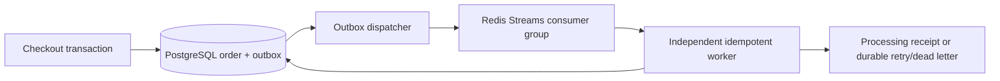

# Backend master plan implementation

E-com Global evolves the existing `donfitex/e-com-glo` repository on `main`. The supplied Backend Development Codex Master Plan is a technical roadmap, not a replacement product specification. Existing global categories, Paystack test checkout, Neon PostgreSQL, Render hosting, real product photos and delivery tracking are retained.

## Baseline and stage mapping

- Stage 0: Node >=22, npm lockfile, strict TypeScript, modular Express services, ignored secrets and local setup already exist.
- Stages 1–2: add isolated native HTTP exercises and an injected, validated concurrent aggregation engine. These do not replace production routes.
- Stage 3: existing validated CRUD/services, request IDs and safe errors remain. Add ISO request timestamps, isolated mock-user exercises and an explicit API contract.
- Stage 4: add versioned bcrypt password hashes with legacy scrypt compatibility and opportunistic upgrades; tighten login throttling without sharing one loopback-IP bucket across all storefront customers. CUSTOMER is the existing equivalent of the plan’s USER role.
- Stage 5: existing Prisma transactions, inventory checks, relational schema and isolated integration databases remain authoritative.
- Stage 6: make cache TTL configurable, add cache measurements and preserve bounded database fallback and shared Redis limits.
- Stage 7: existing non-root multi-stage Docker images, healthy Compose dependencies and GitHub Actions remain; new modules and workers join these checks.
- Stage 8: add a transactional outbox and independent Redis Streams worker with database-backed idempotency, bounded retries and a dead-letter path. Unpaid orders must never be shipped by a worker.
- Stage 9: retain the existing optional local MiniLM adapter, pgvector search, query caching and text fallback. The model is English-oriented; do not claim multilingual quality or universal latency.
- Stage 10: integrate worker lifecycle, safe administrative deep health, release verification and rollback guidance.

Each implementation checkpoint is verified and pushed to `main` before the next begins. No feature branches, remote replacements, production data exports, or secret commits are involved. Existing successful synchronous checkout remains HTTP 201: order creation is already complete. Background acceptance must be recorded transactionally; 202 is reserved for genuinely asynchronous acceptance APIs.

## Design boundaries

Learning examples bind only to loopback and are never mounted in the live commerce API. All commerce writes retain authentication and authorization. Infrastructure configuration is supplied through the host secret manager. Local tests and benchmarks must use isolated databases, never Neon production. Render’s single-replica staging startup migration remains distinct from the documented production release-job procedure.

## Stage 1: isolated native HTTP exercise

Run `npm run learn:http`, then `curl -i http://127.0.0.1:3101/`, `curl -i http://127.0.0.1:3101/api/users`, and `curl -i http://127.0.0.1:3101/api/health`. The built-in HTTP server returns JSON, 200/404 status, process uptime, OS platform and an ISO timestamp. Stop with Ctrl+C. It binds only to loopback and refuses production mode; mock users are static examples, not commerce accounts.

## Stage 2: fault-tolerant aggregation

`aggregate<T>` accepts named HTTPS sources with a Zod schema and an injected fetch implementation. It uses `Promise.allSettled`, five-second request deadlines, redirect rejection, a twenty-source bound and a 1 MiB response bound. Successful typed results survive failed peers; errors expose source labels and safe codes, not provider payloads. It is a library boundary, not a public URL-fetching endpoint. Native fetch/network I/O is not accelerated by increasing `UV_THREADPOOL_SIZE`; no misleading thread-pool benchmark is supplied.

## Stage 3: Express CRUD and observability

Run `npm run learn:crud` for the isolated loopback-only mock-user service on port 3102. It implements validated GET/POST/PATCH/DELETE `/api/users` resources with safe errors and no account/password operations. It is not mounted in production. Production middleware order remains request ID/logging → Helmet/CORS → raw signed webhooks and bounded images → JSON parser → shared rate limits → public routes → authenticated commerce routes → safe errors. Request logs include an explicit ISO timestamp, method, pathname, status and elapsed milliseconds; query strings, credentials and bodies are omitted. Optional integration API keys are not added where no integration route requires them.

## Stage 4: authentication compatibility and throttling

New accounts/admins use bcrypt cost 12 over a versioned base64 SHA-256 prehash, avoiding bcrypt’s 72-byte password truncation for long Unicode input. Existing salted scrypt hashes still verify and are upgraded only after a successful login, using a conditional write to avoid overwriting a concurrent credential change. No account reset or bulk password migration is required. CUSTOMER/ADMIN remains the established RBAC vocabulary. Login attempts use Redis-backed normalized-account buckets (hashed keys), five per 900 seconds; registration retains its separate limit. The storefront’s loopback BFF IP cannot aggregate all legitimate account logins into one bucket. General API throttling and generic credential errors remain in force.

## Stages 5–6: persistence and cache behavior

Existing migrations and real PostgreSQL integration tests cover atomic checkout, insufficient stock, rollback, duplicate checkout keys, concurrent buyers, category/product filtering and order ownership. They remain the persistence implementation rather than being replaced by mock arrays.

`CACHE_TTL_SECONDS` defaults to 3600 (range 1–86400) for public catalog reads. Generation-based invalidation remains authoritative for cache namespaces; checkout always reprices and checks inventory against PostgreSQL. Cache operations have bounded one-second deadlines and database fallback, while unavailable shared login throttling fails closed with a safe 503. A disconnected cache cannot turn authentication limits into unlimited attempts. Cache hit/miss/load/error counters are process-local and reset on restart. If Redis cannot invalidate during an outage, the configured TTL bounds stale public reads; confirmed prices and stock remain database checked.

Measured locally on Linux, Node v24.19.0, PostgreSQL 16/Redis 7, an isolated 25-product dataset, 20-product pages and 50 samples after warm-up: direct database catalog reads had median **2.481 ms**, p95 **4.933 ms**; warm Redis reads had median **0.403 ms**, p95 **0.893 ms**. These are local application-path measurements, not HTTP/network or production guarantees. Reproduce with `BENCHMARK_DATABASE_URL=<isolated URL ending _test> BENCHMARK_REDIS_URL=<local Redis DB 13> npm run benchmark:cache`. The script refuses a production database name.

## Stages 7–8: containers and durable event processing

The existing non-root API and combined staging Docker images and push/PR CI gates remain. Compose now includes an independent `worker` service and Redis AOF (`appendfsync everysec`, `noeviction`, persistent `redis_data` volume). The combined Render staging supervisor runs API, storefront and a separate worker process after migrations. Production should deploy `npm run worker:orders` as its own worker service from the same image; horizontal workers share one logical Redis consumer group.

Checkout atomically records `OrderCreated` in PostgreSQL with order creation and stock reservation. Confirmed payment, cancellation/expiry, shipping and delivery also record lifecycle events in their own transactions. Failed/replayed checkout cannot publish a new event. Synchronous checkout remains 201 because the order is already persisted; authenticated dead-letter redrive returns 202 after its retry state is safely recorded.

The outbox dispatcher publishes event IDs to `ecom:order-events:v1`. Workers use the `ecom:fulfillment:v1` group, database row locks and a durable `OrderWorkItem` projection. The handler reads current order/payment state so delayed events cannot regress fulfillment. Success and its audit record commit in one database transaction before XACK/XDEL. Duplicate messages do not repeat committed effects. A crashed consumer’s pending messages are reclaimed after 30 seconds.

Transient handler errors roll back and persist delays of 1, 2, 4, 8 seconds; the fifth failed processing attempt is dead-lettered. Delays are scheduler lower bounds: the default five-second polling interval can add latency. Invalid payloads go directly to `DEAD`. PostgreSQL is the canonical dead-letter ledger; a bounded Redis dead-letter stream mirrors it. `GET /api/v1/admin/events` lists recent dead letters; `POST /api/v1/admin/events/:id/retry` records an audited retry for an administrator after the underlying problem is fixed. Safe error codes are stored instead of raw exception/provider details.

The database-to-broker failure window is covered by retaining pending/published rows until processing commits. Unprocessed events are republished after 60 seconds, including after broker data loss or an acknowledgement gap. Redis need not be trusted as the only durable store, which matters for staging plans without guaranteed Redis persistence. This is at-least-once delivery with idempotent **database** effects, not a claim of exactly-once emails or other external calls. No customer email/SMS is sent by this implementation. A future external notification handler must use the same stable event ID as its provider idempotency key.

Keep processed events/audit records according to a merchant retention policy; do not indiscriminately trim unprocessed PostgreSQL events. Polling/worker throughput and cache counters are operational signals, not guaranteed SLAs. Worker shutdown stops intake and leaves unfinished work recoverable.

## Stage 9: semantic search and indexing

The existing private local `sentence-transformers/all-MiniLM-L6-v2` adapter remains optional, with validated 384-dimensional nonzero finite vectors, a two-second request deadline, model/filter-aware Redis keys and text fallback. It is an English-oriented model; no multilingual quality claim is made. Explicit price/name sorting remains normal catalog search. Vector indexing requires the optional pgvector schema and a pre-downloaded private model; ordinary commerce does not.

`npm run search:index` now skips unchanged model/source text, processes bounded pages, isolates product failures, reports indexed/skipped/failed counts, returns a failure exit code if any product failed, and invalidates result caches after successful indexing. Model requests happen outside row locks; a short transaction checks the current product before inserting vectors so concurrent edits cannot silently index a different snapshot. Inactive vectors are removed. Source-text guards exclude stale vectors until reindexing, and text fallback keeps new/edited products discoverable. Run this job after catalog imports/edits or on the chosen release scheduler; it is not a claim of continuous model inference in the web process.

A fresh disposable PostgreSQL 16 + pgvector database accepted all six core migrations and the optional vector schema. All vector integration tests ran locally. On Linux/Node v24.19.0, 100 fixture products, 384 dimensions and 50 measured queries after warm-up, pgvector retrieval measured median **4.038 ms**, p95 **4.878 ms**; warm Redis queries measured median **0.405 ms**, p95 **1.023 ms**. These use deterministic fixture vectors and exclude model inference, network hosting and relevance quality. Reproduce with `BENCHMARK_DATABASE_URL=<isolated pgvector URL ending _test> npm run benchmark:search`. Real model latency/quality still needs validation with the deployed model and merchant catalog; the under-100ms brief target is not a universal guarantee.

## Stage 10: integrated release artifact

The API contract is served as OpenAPI 3.1. Administrative deep health includes dependency timing, worker freshness, durable queue backlog, process-local catalog cache counters and V8 memory limits; public endpoints remain shallow/safe. Browser CI now starts the API and a real independent worker, proves checkout events reach `WAITING_PAYMENT`, and runs the authenticated full-stack smoke command. CI also boots the non-root production API and worker images together, checking actual worker heartbeat, before building the combined Render staging image. See [release.md](release.md) for protected environments, direct-connection migrations, live sandbox boundaries, monitoring and rollback.

The original roadmap stages are now covered by either the preserved production implementation or the added isolated exercises, security/cache work, durable workers and release tooling. Provider credentials, cloud plan upgrades, production restores and a real Paystack merchant sandbox charge are not fabricated or performed by test fixtures.
